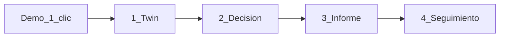

# P7 — Usabilidad del camino crítico

## Decisión de alcance (cerrada)

- **Qué:** pulir UI del flujo ya existente (twin → pack → informe → Twin Loop).
- **Stack:** seguir UI estática same-origin ([`api/financetwin_api/static/`](api/financetwin_api/static/)); **no** Next.js.
- **Reglas:** P-R1 (UI no calcula), sin endpoints nuevos salvo que haga falta un seed mínimo (preferir demo 100% cliente con APIs actuales).
- **Fuera:** V6, PDF, auth, F9, packs nuevos, Monte Carlo, Home/ERP, conectores.

## Entregable documental (primero)

Añadir fase **P7** en [`docs/PLAN_PRODUCTO.md`](docs/PLAN_PRODUCTO.md):

- Objetivo, Hacer / No hacer, DoD checkbox, estado `PENDIENTE` → `HECHA` al cerrar.
- Actualizar §5 checklist, §8 estado global (`fase activa = P7`), changelog.
- Mencionar en [`docs/ARQUITECTURA.md`](docs/ARQUITECTURA.md) / [`docs/DOCUMENTACION.md`](docs/DOCUMENTACION.md) / status breve de [`README.md`](README.md) solo lo real.

## Flujo objetivo

Misma página; navegación por pasos (sticky/stepper). No multi-ruta.

## Cambios de UI (archivos)

| Archivo | Cambio |
|---|---|
| [`index.html`](api/financetwin_api/static/index.html) | Stepper 4 pasos; copy en español de gerente; botón «Cargar demo»; informe con resumen destacado + detalle colapsable; Twin Loop con menos jerga |
| [`styles.css`](api/financetwin_api/static/styles.css) | Stepper, estados activo/hecho, jerarquía del resumen, errores visibles; sin rediseño “marketing” |
| [`app.js`](api/financetwin_api/static/app.js) | Demo one-click (crear empresa + twin + pack `new_site` + defaults ya en `PACK_FORMS`); navegación de pasos; errores parseados a mensajes accionables; sin `Math.` financiero |

### Contenido concreto del polish

1. **Stepper:** Twin | Decisión | Informe | Seguimiento — resalta el paso actual; tras run exitoso salta a Informe.
2. **Lenguaje:** títulos/hints tipo “Caja inicial”, “¿Qué decisión simulas?”; términos API (`ModelVersion`, `policy_id`) solo en detalle/auditoría.
3. **Demo 1 clic:** precarga twin + `new_site` y deja listo “Calcular” / opcionalmente lanza compare; usa endpoints existentes (`POST /companies`, snapshot, packs).
4. **Informe primero:** cards VAN / caja mínima / financiación / políticas (pass-fail); tablas y `pre` de trazabilidad/sensibilidad bajo “Ver detalle”.
5. **Errores:** mapear `detail` FastAPI (string o lista `issues`) a 1–3 frases; no dump JSON crudo en `#error`.
6. **Hints por pack:** una frase bajo el selector (reutilizar `PACK_FORMS[].title` + hint corto).

## Tests

- Nuevo [`api/tests/test_ui_p7.py`](api/tests/test_ui_p7.py): smoke HTML/JS — stepper, texto demo, sin `Math.`, ids clave siguen existiendo.
- Ajustar smokes P2–P6 si cambian labels/ids críticos (`btn-run`, `btn-compare`, `btn-sensitivity`, etc.).
- No tocar engine salvo que un test de UI se rompa por copy (no debería).

## DoD P7

- [ ] `PLAN_PRODUCTO.md` con P7 definida y, al cerrar, `HECHA`
- [ ] Camino guiado 4 pasos en UI estática
- [ ] Demo one-click lleva a informe defendible en &lt;2 min de clic
- [ ] Informe: resumen humano arriba; detalle técnico abajo
- [ ] Errores accionables; cero cálculo financiero en JS
- [ ] Tests UI P7 verdes + smokes previos verdes

## Orden de ejecución

1. Escribir P7 en el plan + checklist.
2. HTML/CSS stepper + copy.
3. JS: demo, navegación, errores, informe colapsable.
4. Tests + marcar HECHA + docs satélite.
